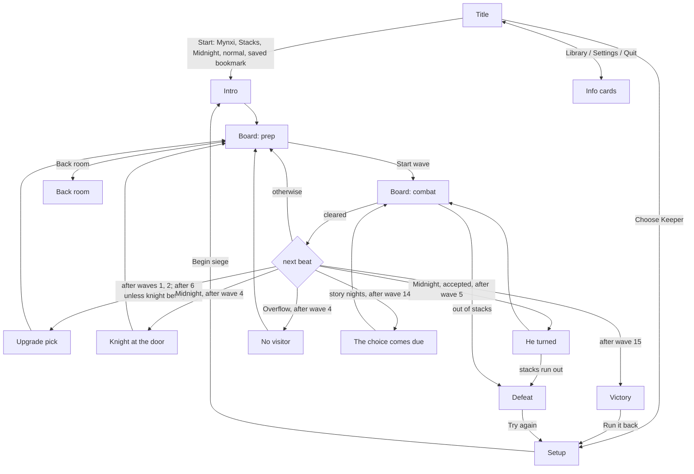
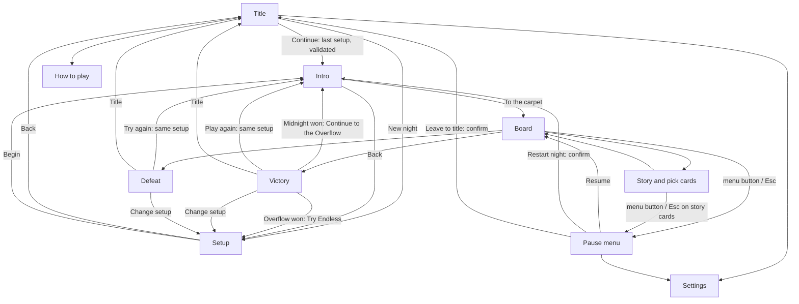

# Melongeddon: Menu Navigation Design

**Status:** revision 2. An independent AI agent reviewed it against the code; its corrections are folded in (see "Review history" at the end).

**Progress:** Phase 1 is built (see 3.6). Part 1 still describes the game before Phase 1.

**Covers:** every screen outside the board itself, plus the board's own controls (HUD, build bar, cannon inspector).

This document has three parts:

1. **As built**: every screen today, how you get in and out, and the controls on each.
2. **Review**: problems found, ranked by how much they hurt a player.
3. **Target design**: how the player should move through the menus, and the work to get there.

Code references are to `src/components/MelonGame.tsx` unless another file is named.

---

## 1. As built

### 1.1 Screens

The game has one route. Which screen shows is decided by `hud.phase` (`Phase` in `src/game/rules.ts`), plus a local `view` inside the title screen.

| Screen | Phase | What the player does | Ways out |
|---|---|---|---|
| **Title** | `coldopen` (view `menu`) | Five buttons: Start, Choose Keeper, Library, Settings, Quit | **Start** → Intro, skipping setup. **Choose Keeper** → Setup. **Library / Settings / Quit** → info cards |
| Title › Library card ("The shelves") | `coldopen` (view `library`) | Reads lore | Back → Title |
| Title › Settings card ("The hall") | `coldopen` (view `settings`) | Sound on/off, music on/off, key list | Back → Title |
| Title › Quit card ("The doors") | `coldopen` (view `quit`) | Reads a joke; nothing quits | Back → Title |
| **Setup** ("Who holds the stacks?"; header reads "Pick a keeper") | `select` | Night, difficulty, bookmark, then map *or* the Overflow door answer, then keeper, then Begin siege | Begin siege → Intro. **No way back to Title** |
| **Intro** (map banner, or the Overflow poster) | `poster` | One button: "To the carpet" or "Cover the chute" | → Board (prep) |
| **Board, between waves** | `prep` | Build, select, sell, back room, Start wave | **Start wave** → Board (combat). **Tap a cannon** → Inspector. **Back room** → Back room |
| **Board, during a wave** | `combat` | Build, select, sell; speed and pause | **Wave cleared** → next beat (see 1.2). **Out of stacks** → Defeat |
| Cannon inspector (replaces the build bar) | `prep`/`combat` | Stats; Back room (prep only); Sell; × close | × / Esc / tapping the **same** cannon again → build bar. Tapping empty floor builds a new cannon and selects it; tapping the carpet does nothing (`engine.ts` ~1256–1290) |
| **Back room** | `shop` | Pick 1 of up to 3 fittings, or "Not now" | → Board (prep) |
| **Upgrade pick** ("Between the waves") | `upgrade` | Pick 1 of 3. No skip | → Board (prep) |
| **Knight at the door** (Midnight only) | `alliance` | Accept / Betray / Send away | → Board (prep) |
| **He turned** (Midnight, knight accepted) | `betrayal` | "Brace" | → Board (combat). **Defeat** if losing the stacks (2, or `michaelTurnCut` for Sir Michael) empties them (`engine.ts` 1296–1311) |
| **The choice comes due** | `consequence` | "Face it" | → Board (combat), finale wave |
| **No visitor** (Overflow) | `memory` | "The chute is next" | → Board (prep) |
| **Victory** | `victory` | Reads result and any unlocks; "Run it back" | → Setup |
| **Defeat** | `defeat` | Reads result and any unlocks; "Try again" | → Setup |

**What end cards reset:** both end buttons call `reset()` (`engine.ts` ~1611). It forces night to Midnight and map to the Stacks, clears the keeper, sets speed to 1× and clears pause. Difficulty and bookmark are kept.

**Header and footer:**
- **Header**: seeds, stacks, absurdity, speed −/+, pause, sound, and music (desktop only). It shows whenever `hud.hero` is set: the Intro, the board, **every story/pick card, the back room and the end cards**.
- **Footer**: the wave bar or Start wave, cannon tabs, the build bar or inspector, and the log line. It shows from the Intro on.

### 1.2 Flow

**Notes on the flow:**
- **Betraying the knight** replaces the wave-6 upgrade with an immediate prize (`rules.ts` ~967).
- **Endless** has no knight, no consequence and no victory. It picks after waves 1, 2 and 6, then every fifth wave, and ends only in Defeat.

### 1.3 Controls today

| Where | Mouse / touch | Keyboard (`src/components/hotkeys.ts`) |
|---|---|---|
| Title, Setup | Buttons | No hotkeys. Tab plus Enter/Space on a focused button works natively; Esc and arrows do nothing |
| Board | Tap floor to build; tap a cannon to select | Q/W/E tab · 1–5 cannon · Space start wave (prep) / pause (combat) · P pause · S sell · B back room · Esc deselect · +/− speed · M sound |
| Upgrade pick | Buttons | 1–3 |
| Back room | Buttons | 1–3, Esc = Not now |
| Knight, He turned, Choice comes due, No visitor, Victory, Defeat | Buttons | No hotkeys (native Tab + Enter only) |
| Anywhere with the header | Header pause/speed/sound/music | M sound. P and +/− only on the board |

**Quirks:**
- Pause persists into the next wave.
- In prep, Space starts a wave even while paused (`hotkeys.ts` 61).
- The "Paused" banner draws over story cards (line 274).

---

## 2. Review

Severity:
- **High**: a player can get stuck or lose progress.
- **Medium**: confusing, slow, or content is easy to miss.
- **Low**: polish.

### High

**H1. Once a run starts there is no way to leave it.** Pause only freezes the board (`togglePause`; the "Paused" label at line 276). There is no pause menu, no restart, no "back to title". To change keeper, map or difficulty mid-run, the player must lose or reload the page.

**H2. Setup has no way back to the Title.**
- `openLibrary()` moves `coldopen → select`, and nothing moves back. Esc does nothing.
- `coldopen` is only reachable on page load, so after the first visit the Title's Library and Settings cards are unreachable until a reload.

**H3. "Run it back" doesn't run it back.** Both end cards send the player to Setup with night forced to Midnight, map forced to the Stacks, no keeper, speed reset to 1×, and pause cleared (see 1.1). Example: a player who just lost on the Archive with Vael presses "Try again" and has to find every choice again.

**H4. On phones, Setup is far too long, and Begin siege is at the very bottom.**
- Measured in the browser at 375×812: the scroll area is 2,484 px for a 727 px view, about 3.4 screens.
- Each keeper card is at least 26rem tall (`min-h-[26rem]`), and cards stack below 768 px (`md:grid-cols-3`), so tablets in portrait suffer too.
- When Begin siege is disabled, the only hint covers the Overflow door question, not a missing keeper (line 1020).

### Medium

**M1. "Start" silently picks Mynxi, the Stacks, Midnight and normal difficulty, plus the saved bookmark.** `onStart` calls `chooseHero("mynxi")` (line 397). The difficulty is always normal, because the Title only exists on page load (`engine.ts` ~362). Nothing on the Title says what Start will use.

**M2. Button names don't match their screens.**
- "Choose Keeper" opens a screen that chooses night, difficulty, bookmark, map *and* keeper.
- "Library" opens lore, while the engine function behind "Choose Keeper" is called `openLibrary`.
- "Quit" quits nothing (it can't in a browser).

**M3. "Stacks" means three things.** It is the normal difficulty ("Stacks"), the first map ("The Stacks"), and the lives counter ("12 stacks"). The map and the difficulty are picked side by side on Setup.

**M4. Keyboard support stops at the board.**
- Title, Setup and the story cards have no hotkeys; only native Tab + Enter works there.
- Board choices use 1–3, but the Knight card, which also has three choices, ignores them.
- On the board, Space is captured by the game, so it can't press a focused button.

**M5. Overlays aren't dialogs.** Story cards, upgrade picks and the back room are plain `div`s. They have no `role="dialog"` or `aria-modal`, focus isn't moved into them, there's no focus trap, and focus isn't returned on close. Screen-reader and keyboard users land behind the overlay.

**M6. Pause and speed work in the wrong places.**
- The header pause and speed buttons stay live during story cards, the back room and end cards. The "Paused" banner then draws over the card.
- Pause carries into the next wave.
- Space in prep starts a wave while paused, so the wave starts frozen.

**M7. The music toggle disappears on phones.** The header music button is `hidden … sm:grid` (line 248). On a phone, music can only be changed from the Title's Settings card, which, per H2, can't be reached after the first visit.

**M8. Winning Midnight doesn't point to the Overflow.** Night two is a toggle on Setup with no lock, but the Victory card never mentions it, even though the door answer is already saved (`writeDoor`). It's discoverable, just not suggested.

**M9. Info cards are out of date.**
- Library (lines 578–579) names only the Stacks, the Annex and the Overflow; the newer maps and cannons are missing.
- Settings' key list (line 589) is hand-written and lacks P (pause) and Space-to-pause.
- `HOTKEY_HELP` in `hotkeys.ts` (line 16) also lacks P.

### Low

**L1.** The Back room button disappears during a wave with no explanation.

**L2.** On phones the title logo is clipped at the sides (already on the art to-do list as a portrait title image).

**L3.** Setup forgets the last keeper. The selected keeper is local React state in `SelectScreen` (line 784), not engine state.

**L4.** The Overflow uses a different intro component (`Poster`) from every other map (`RoomScreen`), even though it now has banner art.

**L5.** End cards have a single button. There's no way to go to the Title, or to change only one setting.

**L6.** The footer log line stays visible under story cards, sometimes repeating the card's text.

---

## 3. Target design

### 3.1 Principles

1. **Every screen has a visible way back.** On keyboards, Esc means close the topmost thing, or open the pause menu if nothing is open. Phones have no Esc, so every back path is also a button.
2. **One primary action per screen**, always in the same place: the gold button, bottom-centre on phones. Enter presses it.
3. **Choices are numbered.** Any card with 2–5 choices accepts 1–5, in on-screen order.
4. **The engine remembers the setup.** The last night, map, difficulty, bookmark and keeper are pre-selected, so "same again" is one press.
5. **Never lose a run by accident.** Leaving a run in progress asks first. That includes the browser's Back button and closing the tab.
6. **Names say what they open.**

### 3.2 Screen map

### 3.3 Engine model (decide before building any screen)

**1. Setup record, owned by the engine.**
- The selected keeper moves out of `SelectScreen`'s local state into `hud.hero`, which is now set while in `select`.
- On Begin, the engine saves `{ night, map, difficulty, bookmark, hero, door }` to storage. `reset()` stops nulling these and only clears the run.

**2. Shared reset.**
- Extract the run-clearing half of `reset()` (enemies, towers, shots, pools, `cleared`, `queue`, `queueCursor`, `karlReward`, `absurdDrops`, run HUD fields) into `resetRunState()`.
- Then:
  - `reset()` = `resetRunState()`, then go to `select`.
  - `restartNight()` = `resetRunState()`, then `chooseHero(savedHero)`.
  - `toTitle()` = `resetRunState()`, then go to `coldopen`.
- `chooseHero` alone is not enough: it doesn't clear run state, and it only runs from `select`/`coldopen`.

**3. Pause model.**
- `hud.menu: "pause" | "settings" | null` lives in the HUD, because `hotkeys.ts` reads only `api.world.hud`.
- Opening the menu sets `paused`; the frame loop checks only `hud.paused`.
- **Quick pause** = P, or Space during a wave. It toggles `paused` only and shows the "Paused" label.
- **Menu** = Esc, or the header menu button. If the game was quick-paused when the menu opened, Resume leaves it unpaused.
- **While the menu is open:** Space, P, digits and +/− are swallowed. Esc or Resume closes it.
- **Starting a wave always unpauses.**
- **On cards:** the header speed buttons are hidden on story/pick cards and end cards, and the pause button becomes the menu button.

**4. Continue validation.** Before Continue starts a run:
- **Map:** if the saved map isn't in `hud.maps`, fall back to the Stacks and say so on the Title.
- **Bookmark:** if the saved bookmark isn't in `hud.unlocked`, fall back to none and say so.
- **Overflow without a door answer:** if the saved night is the Overflow and `readDoor()` is `"none"`, Continue opens Setup with the door row highlighted, instead of failing silently.
- **Summary line:** shows night (including Endless), map or door answer, keeper, and difficulty.

**5. Browser history.**
- Push a history entry when entering Setup, Intro and the board, so the phone's Back gesture moves back one screen instead of leaving the site.
- On the board, Back opens the pause menu.
- Add a `beforeunload` prompt while a run is in progress.

### 3.4 Screen by screen

**Title**
- **Continue**: gold, primary. It shows the summary line from 3.3.4. On a first visit it reads **Start** and uses the defaults.
- **New night**: opens Setup.
- **How to play**: replaces "Library". It covers controls, cannon roles and maps; the lore text moves here.
- **Settings**: the shared panel, below.
- **Quit**: removed on the web. Keep it only in a desktop build that can close its window.
- Keys: ↑/↓ move, Enter selects, Esc on a sub-card returns to the menu.

**Setup** (eyebrow "New night")
- **Order:** Night → Map, or the Overflow door question → Keeper → Difficulty → Bookmark.
- **Defaults:** every row is pre-selected from the setup record, so Begin is never disabled on a return visit.
- **Phone layout:**
  - Keeper cards become a row of three portraits, with the chosen keeper's traits below.
  - Map cards become a row that scrolls sideways.
  - A **sticky footer** holds Back on the left and Begin on the right.
- **Disabled Begin:** the footer gives the reason ("Pick a keeper" / "Say how the first night ended").
- **Keys:** Esc = Back to Title; Enter = Begin; 1–3 = keeper.

**Intro**
- Keeps a single primary button, plus a small Back to Setup.
- The Overflow uses this same banner screen.

**Board**
- **Header:** seeds · stacks · absurdity · speed · **menu** · sound. Music moves into Settings on every screen size.
- **Pause menu:**
  - **Resume** (primary)
  - **Settings**
  - **Restart night**: asks "Restart from wave 1? This run's progress is lost."
  - **Leave to title**: same confirmation.
- **Esc order:** close the back room → close the inspector → open the pause menu.
- **Back room during a wave:** the button is shown greyed with "Between waves", instead of hidden.

**Story and pick cards** (upgrade, knight, He turned, Choice comes due, No visitor, back room)
- **Dialog behaviour:** all use one dialog frame: `role="dialog"`, `aria-modal`, focus on the first choice, Tab trapped inside, and focus returned on close.
- **Choice cards** (upgrade, knight, back room): 1–3 pick. Esc opens the pause menu, except in the back room, where Esc = "Not now".
- **Single-button cards:** Enter presses the button; Esc opens the pause menu.
- **Log line:** the footer log is hidden while a card is open.

**Victory / Defeat**
- **Primary button:**
  - After a Midnight win: **Continue to the Overflow** (saved door answer, same keeper and difficulty).
  - After an Overflow win: **Try Endless**, which opens Setup with Endless selected.
  - After an Endless defeat: **Try again**.
  - Otherwise: **Play again** after a win, **Try again** after a defeat, both with the same setup.
- **Secondary buttons:** **Change setup** and **Title**.
- **Keys:** Enter = primary. Esc does nothing, so new unlocks aren't skipped by accident.
- **Accessibility:** the result is announced (`role="status"` on the title line).

**Settings** (one shared panel, from the Title and the pause menu)
- Sound on/off, music on/off, and default game speed.
- **Reduce motion**: the engine already honours `prefers-reduced-motion`; this adds an in-game override.
- **Key list:** built from `HOTKEY_HELP`, after adding P to it, so the list can't drift.
- **"Show tips again":** clears `melongeddon:tutorial`. Tips only run on waves 1–2 and the hint reads storage once, so it says "Tips will show on your next night."

### 3.5 Wording changes

| Today | Target | Why |
|---|---|---|
| Start | Continue (Start on a first visit) | Says it reuses your setup |
| Choose Keeper | New night | It opens the whole setup |
| Library | How to play | Says what's inside |
| Quit | (remove on web) | A browser tab can't quit |
| Difficulty "Stacks" | "Normal" (see open question 3) | "Stacks" is also a map and the lives counter. "Library" was considered, but clashes with the "Midnight Library" subtitle |
| Begin siege | Begin | Shorter |
| Run it back / Try again | Play again / Try again (same setup) + Change setup + Title | Does what it says |

**Text that must change with these renames:**
- "keeper screen" in `Bookmarks.tsx` (~99), `engine.ts` (~419) and `meta.ts`.
- The README.

### 3.6 Implementation plan

The phases are ordered by player impact and by what each depends on. Each phase can ship on its own.

1. **Setup record and ways out.**
   - The engine model in 3.3: setup record, `resetRunState`, `toTitle`, `restartNight`, pause model, Continue validation.
   - Pause menu; Setup Back; Intro Back; end-card buttons (Play again / Change setup / Title / Continue to the Overflow).
   - Fixes H1, H2, H3, M1, M6, M8, L3, L5.
   - **Built.** Tests in `tests/navigation.test.ts`. Pulled forward from later phases because they were small: the Title's Start/Choose Keeper became Continue/New night; Esc goes back on Setup and the Intro and opens the menu on story cards; P added to `HOTKEY_HELP`; the pause menu's Settings has the music toggle, so phones can reach it mid-run; a `beforeunload` prompt during a run. Browser-history entries are left for Phase 2.
2. **Phone setup layout.** Sticky Back/Begin footer, compact keeper row, sideways map row, reason line, and browser-history entries. Fixes H4.
3. **Keyboard and dialogs.**
   - Move key handling into a pure function `(hud, key) => action`, so it can be tested without a DOM.
   - A shared `Dialog` wrapper; digits for all choice cards; arrows on the Title.
   - Fixes M4, M5.
4. **Names and content.**
   - The wording table, How to play content, and the Settings panel (key list, reduce motion, tips).
   - Music toggle into Settings; the same intro screen for the Overflow; the greyed Back room button.
   - Fixes M2, M3, M7, M9, L1, L4, L6.

**Tests to add** (`node --test`, no DOM):
- `restartNight` and `toTitle` clear the run and keep the setup record.
- `reset()` keeps night, map, keeper, difficulty and bookmark.
- Continue falls back from a locked map or bookmark, and routes an Overflow with no door answer to Setup.
- Continue to the Overflow uses the saved door answer.
- The pure key function follows the Esc order, swallows keys while the menu is open, and starting a wave unpauses.

**Deferred:**
- A "Try it" link for newly unlocked maps.
- "Restart wave", which needs a board snapshot.

### 3.7 Open questions

1. Should Endless get its own Title entry, since it has its own best score, rather than living as a Night toggle?
2. Should the Title's Continue also resume a run in progress after a reload? That would need saving the board mid-run, which the game doesn't do today.
3. Rename only the normal difficulty ("Normal"), or all three together, keeping the library tone (e.g. Story / Shelved / Melongeddon)?

---

## Review history

**Revision 1** was reviewed by an independent AI agent, which read the code without the author's context. Verdict: **ready with changes**.

**Corrected in Part 1:**
- "He turned" can end in Defeat.
- Betraying the knight skips the wave-6 pick.
- Only re-tapping the same cannon closes the inspector.
- Start always uses normal difficulty plus the saved bookmark.
- `HOTKEY_HELP` also lacks P.
- Native Tab + Enter works off the board.
- Pause and speed stay live on cards.
- `reset()` also resets speed and pause.

**Re-ranked:** "Winning Midnight doesn't lead to the Overflow" moved from High to Medium (M8). The Overflow is selectable; it just isn't suggested.

**Added to Part 3:**
- The engine model (3.3): an engine-owned setup record, `resetRunState`, the pause model, Continue validation, and browser history.
- Pause menu access over story cards.
- Victory Esc does nothing.
- "Try Endless" after an Overflow win.
- The rename knock-ons, and "Normal" instead of "Library" for the difficulty.
- "Show tips again" applies next night.
- A pure key function for testing, plus reduce motion and `aria-modal` / focus return.

**Re-phased:** the setup record moved into Phase 1, so phases don't depend on later ones. "Try it" links and "Restart wave" are deferred.
