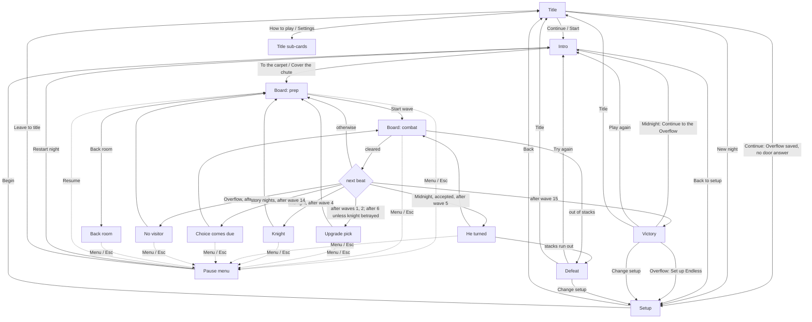

# Melongeddon: Menu Navigation

**Status:** revision 3. Describes the game as shipped after all four redesign phases (commits `84e15e7`, `fadbde4`, `e9792fc`, `d03bcd0`, plus the revision-3 fixes noted in the Review history).

**How to read this document:**

1. **Current menus** is the source of truth: every screen, every button and the engine function it calls, the keys, and the less obvious paths.
2. **Original review** lists the problems found before the redesign and what happened to each one.
3. **Design rules and remaining work** covers the principles, the engine model, the delivery record, and what is still open.
4. **Appendix A** briefly describes the game before the redesign, for context only.

Code is referred to by file and function name. Line numbers go stale, so this document doesn't use them.

---

## 1. Current menus

### 1.1 Screens

Which screen shows is decided by `hud.phase` (`Phase` in `src/game/rules.ts`). The pause menu is `hud.menu` and sits on top of the current phase. The Title's sub-cards are local state in `TitleScreen`.

| Screen | Phase | What's on it | Ways out |
|---|---|---|---|
| **Title** | `coldopen` | Gold **Continue** button (**Start** on a first visit) with a summary line under it, then **New night**, **How to play**, **Settings** | Continue → `continueRun()` → Intro (or Setup, see 1.4). New night → `openSetup()` → Setup. The other two open sub-cards |
| Title › How to play | `coldopen` | Basics, every cannon by tab, keepers, nights, rooms with unlock goals, keys. Scrolls inside the card | Back / Esc → Title |
| Title › Settings | `coldopen` | The shared Settings panel (1.6) | Back / Esc → Title |
| **Setup** | `select` | Rows: Night → Room (or the Overflow door question) → Keeper → Difficulty → Bookmark. Pinned footer with Back, Begin and a reason line | Back → `backToTitle()` → Title. Begin → `chooseHero(hud.hero)` → Intro |
| **Intro** | `poster` | The room's banner art (the Overflow included), keeper title, a joke, one gold button, a small "Back to setup" | **To the carpet** / **Cover the chute** → `beginNight()` → Board. Back to setup → `backToSetup()` → Setup |
| **Board, between waves** | `prep` | Header, Start wave, cannon tabs, build bar or inspector, log line | Start wave → combat. Back room (inspector) → Back room. Menu button / Esc → Pause menu |
| **Board, during a wave** | `combat` | Header, wave bar, tabs, build bar or inspector | Wave cleared → next beat (1.3). Out of stacks → Defeat. Menu / Esc → Pause menu |
| Cannon inspector | `prep` / `combat` | Stats, fittings, **Back room *price*** (between waves) or a greyed **Between waves** (during a wave), **Sell**, × | × / Esc / tapping the same cannon → build bar |
| **Back room** | `shop` | Up to three fittings, **Not now** | Pick or Not now / Esc → Board |
| **Upgrade pick** | `upgrade` | Three upgrades, no skip | Pick → Board |
| **Knight at the door** (Midnight) | `alliance` | Accept / Betray / Send away | Pick → Board |
| **He turned** (Midnight, accepted) | `betrayal` | **Brace** | → combat, or Defeat if the stack cut empties the stacks |
| **The choice comes due** | `consequence` | **Face it** | → combat (finale wave) |
| **No visitor** (Overflow) | `memory` | **The chute is next** | → Board |
| **Pause menu** | `hud.menu` over any run phase except the Intro and end cards | **Resume**, **Settings**, **Restart night**, **Leave to title** | Resume / Esc → `closeMenu()` → where you were. Restart and Leave ask first, then `restartNight()` → Intro or `toTitle()` → Title |
| **Victory** | `victory` | Result, any new unlocks, a primary button, secondary buttons | See 1.2 |
| **Defeat** | `defeat` | Result, any new unlocks, **Try again**, **Change setup**, **Title** | See 1.2 |

### 1.2 What each button calls

Every navigation function first runs `resetRunState()` where a run is being thrown away. That clears the board, waves, picks, seeds and stacks, and **keeps the setup**: night, map, difficulty, bookmark, keeper, the Overflow door answer, and the game speed.

| Engine function | Goes to | Called by |
|---|---|---|
| `continueRun()` | Intro, or Setup if the saved night is the Overflow with no door answer | Title **Continue** / **Start** |
| `openSetup()` | Setup | Title **New night** |
| `backToTitle()` | Title | Setup **Back**, Esc on Setup, browser Back on Setup |
| `chooseHero(hero)` | Intro, and saves the setup record | Setup **Begin**, Enter on Setup |
| `backToSetup()` | Setup | Intro **Back to setup**, Esc on the Intro, browser Back on the Intro |
| `restartNight()` | **Intro**, same setup | Defeat **Try again**, Victory **Play again**, pause menu **Restart night** |
| `reset()` | **Setup**, choices kept | Victory / Defeat **Change setup** |
| `toTitle()` | Title | Victory / Defeat **Title**, pause menu **Leave to title** |
| `continueOverflow()` | Overflow Intro, same keeper, difficulty and bookmark | Victory after Midnight: **Continue to the Overflow** |
| `tryEndless()` | Setup with Endless selected and the room set to The Stacks | Victory after the Overflow: **Set up Endless** |

**End-card buttons by result:**

| Result | Primary (gold, focused, Enter) | Secondary |
|---|---|---|
| Midnight won | Continue to the Overflow | Play again · Change setup · Title |
| Overflow won | Set up Endless | Play again · Change setup · Title |
| Any defeat (Endless included) | Try again | Change setup · Title |

Endless has no victory, so it never shows the first table's Play again.

### 1.3 Flow

The dotted Resume arrow returns to whichever screen the menu was opened from, not only to prep.

**Pacing:** a story night is 15 waves. Endless picks after waves 1, 2 and 6, then every fifth wave, and ends only in Defeat.

### 1.4 Less obvious paths

- **Continue, then Back on the Intro, lands on Setup, not the Title.** The Intro's Back always means "change my setup", wherever you came from. A second Back (or Esc) reaches the Title.
- **Pause menu over a story or pick card:** the card stays open underneath and becomes inert, so only one modal dialog is active at a time. Resume or Esc closes the menu and returns to the same card, with focus back on the button it had. The card's choice is not made for you.
- **Pause menu over the back room:** the header menu button opens it. Esc in the back room means "Not now", not "menu".
- **Restart / Leave confirmations:** "Keep playing" returns to the pause menu. Esc closes the whole menu and resumes.
- **Back room during a wave:** the inspector shows a greyed **Between waves** button, and **B** does nothing until the wave ends.
- **Continue to the Overflow with no door answer:** it uses this run's knight answer, then the saved one. If neither exists it opens Setup with the door question outlined. A Midnight run can't normally reach Victory without answering the knight after wave 4, so this is a safety net.
- **Continue on the Title after a map or bookmark was re-locked** (for example, cleared storage): it falls back to The Stacks or no bookmark, and a gold note under the summary says so.
- **First visit:** the gold button reads **Start**. The summary shows the defaults (Midnight · The Stacks · Mynxi · Normal difficulty) plus "Pick your own with New night." It reads **Continue** once any night has been begun, because the setup is saved on Begin.
- **Closing or reloading the tab mid-run:** the browser asks first. The run itself is not saved (open question 2).
- **Phone / browser Back:** on Setup it goes to the Title. On the Intro it goes to Setup. On the board or a card it opens the pause menu, a second Back closes it, and in the back room it means Not now. On end cards it does nothing. On the Title it leaves the site.

### 1.5 Controls

Key rules live in one pure function, `keyAction(hud, key)` in `src/game/keys.ts`; `runKeyAction` applies the result. The React hook in `src/components/hotkeys.ts` only handles typing in inputs, focused buttons and `preventDefault`.

| Where | Keys |
|---|---|
| Title | ↑/↓ move through the buttons (focus starts on Continue), Enter presses the focused one, Esc closes a sub-card |
| Setup | 1–6 keeper, Enter Begin (when ready), Esc Back |
| Intro | Enter goes to the carpet, Esc back to Setup |
| Board | Q/W/E/R tab (R = the keeper's own tower) · 1–5 cannon · Space starts the wave between waves and pauses during one · P quick pause · S sell · B back room (between waves, cannon selected) · Esc closes the inspector, then opens the pause menu · +/− speed · M sound |
| Upgrade pick | 1–3 pick, Esc pause menu |
| Back room | 1–3 fit, Esc Not now |
| Knight | 1–3 (Accept, Betray, Send away), Esc pause menu |
| He turned, Choice comes due, No visitor | Enter presses the button, Esc pause menu |
| Victory / Defeat | Enter presses the primary button. Esc does nothing, so new unlocks aren't skipped |
| Pause menu | Esc closes it (from its Settings, Esc goes back to the menu first). Space, P, digits and +/− are ignored. M still works |

**Rules that apply everywhere:**
- **Focused buttons:** a button reached by keyboard (`:focus-visible`) keeps its own Enter and Space. A button that only has focus because it was clicked doesn't, so Space still starts the wave after you click a cannon.
- **Pausing:** quick pause works only on the board, never under the menu. Starting a wave always unpauses.
- **Hints:** desktop shows number hints on choice cards and "Enter" / "Esc" hints on single-button cards and Not now.

### 1.6 Screen details

**Title**
- **Summary line:** `setupSummary()` gives night · room (or the door answer on the Overflow) · keeper · difficulty · bookmark, for example "Midnight · The Archive · Vaelithra · Melongeddon difficulty".
- **Fallback note:** any note from `validateSetup()` appears in gold under the summary.
- **Quit:** removed. A browser tab can't quit.

**Setup**
- **Layout:** the content scrolls in its own area. The footer is pinned and holds **Back** (left), **Begin** (right) and, when Begin is off, a red reason line: "Pick a keeper." or "Say how the first night ended."
- **Door question:** when unanswered on the Overflow, it is also outlined in red.
- **Phones (below 768 px for keepers, below 640 px for rows):**
  - Keepers are portraits in rows of three (six keepers), with the chosen keeper's role, flavour line, traits and signature tower in a panel below.
  - Rooms and bookmarks are single rows that scroll sideways.
  - Measured at 375×812: 912 px of scrolling for a 660 px view with three keepers; 1,110 px for a 688 px view after the second row of keepers was added. Begin is always visible.
- **Wider screens:** the large keeper cards and room/bookmark grids.

**Board header**
- **Contents:** seeds · stacks · absurdity (desktop) · speed −, pause, + (board phases only) · menu · sound.
- **Music:** lives only in Settings. Speed and pause are hidden on cards. The book icon hides on phones during a run, so the header fits 375 px.

**Cards** (back room, upgrade, knight, He turned, Choice comes due, No visitor, end cards) **and the pause menu**
- **Shared dialog:** all use `Dialog` (`src/components/Dialog.tsx`):
  - `role="dialog"` and `aria-modal`, labelled by the card title
  - focus moves to the `data-autofocus` element or the first button
  - Tab is trapped inside, and focus returns on close
- **Footer:** the board footer, including the log line, is hidden while a card is open.
- **End-card title:** has `role="status"`, so the result is announced.

**Settings panel** (`SettingsPanel`, the same component on the Title and in the pause menu)
- **Sound** and **Music**.
- **Game speed:** 0.5× / 1× / 2× / 3×. It sets the current speed and saves it as the default.
- **Reduce motion:** saved, and overrides the system's `prefers-reduced-motion`. It turns off screen shake.
- **Show tips again:** clears the tutorial flag and says "Tips will show on your next night."
- **Key list:** built from `HOTKEY_HELP`, so it can't drift.

**Focus ring:** a gold `:focus-visible` outline with a dark gap, in `src/styles.css`.

### 1.7 Where things live

| What | Where |
|---|---|
| Setup record, validation, navigation functions, pause state, speed and reduce-motion settings | `src/game/engine.ts` (`SetupRecord`, `validateSetup`, `resetRunState`, the api functions in 1.2, `openMenu`/`closeMenu`/`menuSettings`, `setSpeed`, `setReduced`) |
| Key rules | `src/game/keys.ts` |
| Key listener | `src/components/hotkeys.ts` |
| Dialog frame | `src/components/Dialog.tsx` |
| Screens, pause menu, Settings panel, How to play, browser history, leave-page prompt | `src/components/MelonGame.tsx` |
| Saved in the browser | `melongeddon-setup` (setup record), `melongeddon-door`, `melongeddon-bookmark`, `melongeddon-speed`, `melongeddon-reduced`, `melongeddon:tutorial` |

### 1.8 Tests

`npm test` runs 59 tests with `node --test` and no DOM.

**`tests/navigation.test.ts` (19 tests):**
- Setup keeps the keeper.
- `reset`, `restartNight` and `toTitle` clear the run and keep the setup.
- Back from the Intro removes Sir Michael's free cannon.
- Continue: first-visit defaults, pre-selection from a saved setup, locked map/bookmark fallback with a note, junk ignored.
- The Overflow: no door answer → Setup; a saved answer starts it.
- Continue to the Overflow uses this run's answer, and Set up Endless opens Setup.
- Pause menu: it pauses and blocks quick pause and waves; Resume unpauses; it can't open on the Title, Setup, Intro or end cards; starting a wave unpauses.
- Settings: speed values, and reduce motion.

**`tests/keys.test.ts` (11 tests):**
- Esc order on the board, and in the menu's Settings.
- Keys ignored under the menu; Space-to-start while quick-paused.
- Setup digits, Enter and Esc; Intro Enter.
- Knight 1–3; Enter on single-button cards; end-card Enter and Esc; back-room digits and Esc.
- The Title leaving keys to its own buttons.

---

## 2. Original review

These findings were written against the game **before** the redesign (Appendix A). Each now has a status.

Severity:
- **High**: a player can get stuck or lose progress.
- **Medium**: confusing, slow, or content is easy to miss.
- **Low**: polish.

| ID | Finding (before the redesign) | Status |
|---|---|---|
| H1 | No way to leave a run: pause only froze the board | **Fixed, phase 1.** Pause menu with Restart night and Leave to title |
| H2 | Setup had no way back; the Title was reachable only by reloading | **Fixed, phase 1.** Setup Back, Esc, browser Back |
| H3 | "Run it back" went to Setup and wiped the night, map and keeper | **Fixed, phase 1.** Play again / Try again restart the same setup; Change setup keeps choices |
| H4 | Phone Setup far too long, with Begin at the bottom | **Fixed, phase 2.** 912 px of scrolling, Begin pinned. See the note below |
| M1 | Start silently used Mynxi, the Stacks, Midnight and normal | **Fixed, phase 1.** Continue shows a summary line; first-visit Start shows the defaults |
| M2 | Button names didn't match their screens | **Fixed, phases 1 and 4.** New night, How to play, Quit removed, and the engine's `openLibrary` is now `openSetup` |
| M3 | "Stacks" meant a difficulty, a map and the lives counter | **Mostly fixed, phase 4.** The difficulty is now "Normal". The map "The Stacks" and the lives counter "stacks" keep the word on purpose: it's the game's word for lives |
| M4 | Keyboard support stopped at the board | **Fixed, phase 3** |
| M5 | Overlays weren't dialogs | **Fixed, phase 3.** Plus, in revision 3, one modal at a time under the pause menu |
| M6 | Pause and speed worked in the wrong places; Space started a frozen wave | **Fixed, phase 1** |
| M7 | No music toggle on phones mid-run | **Fixed, phases 1 and 4.** Music is in Settings on every screen size |
| M8 | Winning Midnight didn't point to the Overflow | **Fixed, phase 1.** Continue to the Overflow |
| M9 | Info cards and key lists out of date | **Fixed, phase 4.** How to play is generated from game data; key lists come from `HOTKEY_HELP` |
| L1 | Back room button vanished during a wave | **Fixed, phase 4.** Greyed "Between waves" |
| L2 | Phone title logo clipped at the sides | **Open, deferred.** Needs a portrait title image (art). See 3.5 |
| L3 | Setup forgot the last keeper | **Fixed, phase 1.** The keeper lives in the engine and the saved setup |
| L4 | The Overflow used a different intro screen | **Fixed, phase 4** |
| L5 | End cards had a single button | **Fixed, phase 1** |
| L6 | The log line showed under story cards | **Fixed, phase 4** |

**About the H4 numbers:**
- **2,484 px:** measured for revision 1, before any phase.
- **2,849 px:** the "before" figure in the phase 2 commit, measured after phase 1 had added the Back button row and the summary changes.
- **912 px:** after phase 2.

---

## 3. Design rules and remaining work

### 3.1 Principles

1. **Every screen has a visible way back.** On keyboards, Esc closes the topmost thing, or opens the pause menu if nothing is open. Phones have no Esc, so every back path is also a button, and the phone's Back gesture follows the same steps.
2. **One primary action per screen**, always the gold button, focused, pressed by Enter.
3. **Choices are numbered.** Cards with 2–3 choices accept 1–3, in on-screen order.
4. **The engine remembers the setup**, so "same again" is one press.
5. **Never lose a run by accident.** Restart and Leave ask first, and closing the tab asks first.
6. **Names say what they open.** For example, "Set up Endless" opens Setup instead of starting a run.

### 3.2 Engine model

1. **Setup record.**
   - **Contents:** `{ night, map, difficulty, bookmark, hero, door }`.
   - **Saved:** by `chooseHero` on Begin.
   - **On load:** read back, run through `validateSetup()`, and applied to the HUD so every Setup row is pre-selected. The bookmark comes from the separately saved pick, which is newer.
   - **The keeper:** lives in `hud.hero` from Setup onward, so the UI decides "in a run" by phase, not by `hud.hero`.
2. **Shared reset.** `resetRunState()` clears the run and keeps the setup and speed. Section 1.2 lists the functions built on it.
3. **Pause model.**
   - **State:** `hud.menu` is `"pause"`, `"settings"` or `null`. Opening the menu pauses the game, and closing it always unpauses.
   - **Quick pause:** P, or Space during a wave. It toggles `paused` only, and only on the board.
   - **Waves:** `startWave` refuses to run under the menu and always unpauses.
4. **Continue validation.** `validateSetup()` falls back from unknown values, re-locked maps and re-locked bookmarks, with a note. `continueRun()` routes an Overflow without a door answer to Setup.
5. **Browser history.**
   - **Spare entry:** while you're away from the Title, the page keeps one extra history entry. Each Back uses it, does the in-game back step in 1.4, and puts it back unless that step reached the Title.
   - **Back to the Title by button:** reaching the Title with a button drops the spare entry, so Back from the Title leaves the site as usual.
   - **Leaving mid-run:** a `beforeunload` prompt runs during a run.

### 3.3 Wording (decided)

| Before | Now |
|---|---|
| Start | Continue (Start on a first visit) |
| Choose Keeper | New night |
| Library ("The shelves") | How to play |
| Settings ("The hall") | Settings |
| Quit | Removed on the web; the desktop app (Electron) shows Quit on the Title |
| Difficulty "Stacks" | "Normal" (Story and Melongeddon unchanged; open question 3, decided) |
| Begin siege | Begin |
| Run it back / Try again | Play again / Try again (same setup), Change setup, Title, plus Continue to the Overflow and Set up Endless |
| "keeper screen" (bookmark text, unlock messages, comments, README) | "setup screen" |

### 3.4 Delivery record

| Phase | Commit | Scope | Fixed |
|---|---|---|---|
| 1. Setup record and ways out | `84e15e7` | Engine model, pause menu, Setup and Intro Back, end-card buttons, Continue with summary. Pulled forward: Continue / New night names, Esc on Setup, the Intro and story cards, P in `HOTKEY_HELP`, music in the pause menu's Settings, leave-page prompt | H1, H2, H3, M1, M6, M8, L3, L5 |
| 2. Phone setup layout | `fadbde4` | Scroll area plus pinned footer, reason line, door outline, compact keepers, sideways rooms and bookmarks, browser history | H4 |
| 3. Keyboard and dialogs | `e9792fc` | `keys.ts`, `Dialog`, digits and Enter everywhere, Title arrows, focus ring, hints | M4, M5 |
| 4. Names and content | `d03bcd0` | Wording, How to play, shared Settings panel, music out of the header, same intro for the Overflow, greyed back room, footer hidden under cards | M2, M3, M7, M9, L1, L4, L6 |
| Revision 3 fixes | this revision's commit | Card inert under the pause menu, "Set up Endless", `openLibrary` → `openSetup` | M2, M5 follow-ups |

### 3.5 Remaining and deferred

- **L2, phone title clipping.** Needs a portrait crop or a portrait title image. It's on the art to-do list.
- **"Try it" link for a newly unlocked map** on the end card.
- **"Restart wave".** Needs a board snapshot.
- **Resume a run after a reload** (open question 2).

### 3.6 Open questions

1. Should Endless get its own Title entry, since it has its own best score, rather than living as a Night toggle on Setup?
2. Should Continue also resume a run in progress after a reload? That needs saving the board mid-run, which the game doesn't do.

**Decided:** question 3 from revision 2 ("rename only the normal difficulty, or all three?"). Only the normal difficulty was renamed, to "Normal". It can be revisited.

---

## Appendix A: before the redesign

For context only. Don't use this to find code.

- **Title:** five buttons: Start (always Mynxi, the Stacks, Midnight, normal, plus the saved bookmark), Choose Keeper, Library (lore), Settings (sound, music, a hand-written key list) and Quit (a joke card). The Title only existed on page load.
- **Setup:**
  - Night and difficulty side by side, then bookmark, then room or door, then three tall keeper cards, with Begin siege at the bottom.
  - The keeper was React state, forgotten on each visit.
  - There was no Back.
- **Overflow intro:** a separate plain poster card.
- **Board:** pause and speed buttons in the header, live everywhere, including over cards. Pause carried into the next wave. A music button on desktop only. The back-room button disappeared during waves.
- **Cards:** plain overlays, with no dialog role or focus handling. Digits worked only on the upgrade and back-room cards.
- **End cards:** one button ("Run it back" / "Try again"). It went to Setup with the night forced to Midnight, the map to the Stacks, no keeper and speed reset.

---

## Review history

**Revision 1** was reviewed by an independent AI agent, which read the code without the author's context. Verdict: **ready with changes**.
- **Corrected:** "He turned" can end in Defeat; betraying the knight skips the wave-6 pick; only re-tapping the same cannon closes the inspector; Start always used normal difficulty plus the saved bookmark; `HOTKEY_HELP` also lacked P; native Tab + Enter worked off the board; pause and speed stayed live on cards; `reset()` also reset speed and pause.
- **Re-ranked:** M8 from High to Medium.
- **Added:** the engine model, pause-menu access over story cards, Victory Esc doing nothing, a button after an Overflow win, the rename knock-ons, "Normal" instead of "Library" for the difficulty, "Show tips again" applying next night, the pure key function, reduce motion, and `aria-modal` with focus return.
- **Re-phased:** the setup record moved into Phase 1. "Try it" links and "Restart wave" were deferred.

**Revision 2** carried those corrections and served as the build plan. Phases 1–4 shipped against it, each adding a "Built" note.

**Revision 3** answers a second review, which found the document contradicting itself after the build.

*Structure:*
- Part 1 described the old game while the header said everything had shipped. Part 1 is now the current game, and the old one is Appendix A.
- Shipped behavior lived only in the phase notes. It is now folded into 1.1–1.6.
- Stale line numbers were removed.

*Contradictions resolved:*
- `reset()` vs Play again: 1.2 lists which function each button calls. Play again and Try again call `restartNight()` (Intro); Change setup calls `reset()` (Setup).
- The H4 numbers are explained.
- Section 3.3 no longer points at a decided question.

*Paths now specified:*
- Pause menu over a card.
- Continue → Intro → Back reaching Setup.
- Continue to the Overflow with no door answer.
- B during a wave.
- Esc from a confirmation.
- The first-visit Start label.
- The summary line contents.

*Tests:* now described in the past tense, with file names and counts.

*Status:* L2 is listed as open and deferred, instead of falling off the plan.

*Code changes made with this revision:*
- The story card underneath the pause menu is now `inert`, so only one modal dialog is active. Before, both were marked modal.
- "Try Endless" is renamed "Set up Endless", since it opens Setup.
- The engine's `openLibrary` is renamed `openSetup`.

*Not a defect:* the review said `src/game/keys.ts`, `src/components/Dialog.tsx` and `tests/navigation.test.ts` don't exist. They exist and are committed in `e9792fc` and `84e15e7` (`tests/keys.test.ts` too). The reviewer was likely reading a copy from before phase 1.
